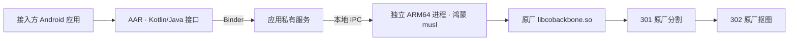

# 在 Android 上运行华为原始 Core Vision Kit

更新于 2026-11-25。

## 结论与范围

**Android 真机已在普通 ADB shell 下直接运行华为原始主体分割引擎。** 在一台未 root、SELinux 为 Enforcing 的 ARM64 手机上，独立进程使用鸿蒙 musl 加载器运行原始 `libcobackbone.so`，通过华为 DLLite 和 MindSpore Lite CPU 后端依次执行主体分割（301）和精细抠图（302）。同一输入与鸿蒙真机 `subjectSegmentation` 对照，302 的前景 IoU 为 **0.99700**（阈值 `>128`）。

Android AAR 提供 Kotlin/Java 接口，通过本地工作进程运行主体分割、精细抠图、人脸检测与比对、物体检测、骨骼检测、OCR、超分和以文搜图。示例宿主使用普通应用权限运行。主体分割的合并蒙版与鸿蒙真机做过同像素对照，同一 Android 模拟器上的离线验收覆盖各项能力。[华为主体分割 API](https://developer.huawei.com/consumer/cn/doc/doccenter-references/api/core-vision-subjectsegmentation-api.md) · [Android 库与 AAR](https://developer.android.com/studio/projects/android-library)

## 真机实测

| 环境 | 实测条件 |
| --- | --- |
| 鸿蒙基线 | 华为畅享 90 Plus（`JUY-AL50`），HarmonyOS `7.0.0.111`，API `26`，`arm64-v8a`，调用公开 ArkTS API。 |
| Android 验证 | realme `RMX5010`，Qualcomm `SM8750`，Android `17`，API `37`，`arm64-v8a`，4 KiB 页，`user` 构建。 |

### 输出对照

两端使用 SHA-256 一致的 `1536 × 1024` RGBA 像素。鸿蒙返回 `subjectCount = 1`、`subjectRectangle = {left: 57, top: 0, width: 1446, height: 1024}`、前景图和原尺寸 `mattingList`。Android 两个场景均返回 `512 × 512` 浮点掩码，分数均为 `0.971191`。对照时先对浮点掩码做双线性上采样，再换算到 `0–255`。

| Android 输出与鸿蒙 `mattingList` 对照 | IoU（`>128`） | 阈值像素一致率 | MAE | RMSE |
| --- | ---: | ---: | ---: | ---: |
| 301 主体分割中间掩码 | 0.99167 | 99.510% | 1.864 | 13.081 |
| 302 精细抠图 alpha | **0.99700** | **99.824%** | **0.591** | **4.219** |

以 302 上采样后的浮点 alpha 预乘输入 RGB，再逐通道四舍五入生成 RGBA。与鸿蒙前景图比较，alpha 字节一致率为 `93.33%`，四个通道均相同的像素占 `87.50%`，全通道 MAE 为 `0.669`。同一张图重复启动 Android 探针，301 和 302 的量化掩码分别保持字节一致。

Android 补充用例包括一张合成双主体图和一张纯渐变图。双主体图的 301 掩码在 `>128` 时有两个连通域，分数为 `0.946777`。纯渐变图的 301 掩码全为 `0`，302 无 `>128` 的前景像素。新接口返回合成图的两个主体及各自蒙版，纯色图的主体数为零。

### 耗时与内存

| 测量项 | Android 探针结果 | 口径 |
| --- | --- | --- |
| 新进程完成 301 和 302 | `3.37 / 3.38 / 3.40 s` | 三次独立启动，使用设备现有文件缓存，包含初始化和结果写盘。 |
| 301 场景创建和初始化 | `2.02–2.42 s` | 来自独立的分段计时实验。 |
| 301 提交至 302 取到结果 | `0.722 / 0.761 / 0.766 s` | 同一轮的三次样本，包含中间装配、302 初始化和结果轮询。 |
| 同一 301 场景连续追加五次 | 每次约 `0.30 s` | 每次重置输出状态并使用新的请求缓存，探针以 100 ms 间隔轮询。 |
| 同进程重建 301 后执行一次 | `1.122 s` | 一次观测，含销毁、创建、初始化和取到新结果。 |

一组 301 连续请求中，RSS 从首个追加请求后的约 `332 MiB` 升至第五个请求后的约 `391 MiB`，清理场景后降至约 `175 MiB`。发布前需在 APK 宿主中复核对象生命周期、双场景连续调用和进程峰值内存。

## 原厂产物

`coBackboneService` 和 `commonHsp` 来自华为 Mate 60 `BRA-AL00` 的官方基础固件 `BRA-LGRP1-CHN 207.0.0.111(SP10)`。这两个模块与鸿蒙对照机上的 `70.19.9.308` 版本具有相同的模块 `buildHash` 和发布证书指纹。以下 SHA-256 对应本次选用的原厂文件。

| 原件 | 用途 | SHA-256 |
| --- | --- | --- |
| `hms-core-ml-coBackboneService-signed.hap` | 引擎和 `resources/resfile/` | `afcfc5f9efb17ae872f13cd3de39f0658a58fddf5972f2b25566d4f8506da83e` |
| `hms-core-ml-commonHsp-signed.hsp` | DLLite、OpenCV 和配套 C++ 运行时 | `ea15ce4c898389fd4fca3726d5003bc56885e738784b2f3009f522e75690d053` |
| `libcobackbone.so` | Android 探针实际加载的华为引擎 | `f2b1037b736b1a50205d86d75bd454826e7326a8fdce91f3414d6c3b77173f56` |

该 HAP 的签名配置为 `release`、分发类型为 `os_integration`，无设备 ID 白名单。两个型号上的同构建记录支持该组件随系统跨机型发行。完整 HAP 的安装和服务注册仍由目标系统的发布证书信任、系统集成权限和配套模块决定。Android 验证从原件加载 ELF 和模型资源。[OpenHarmony 应用签名配置](https://github.com/openharmony/docs/blob/master/zh-cn/application-dev/security/app-provision-structure.md)

资源目录包含 `backbone_640.ms`、`head_segment_640.ms`、`salient_matting.onnx.ms` 和配套的 `cobackbone.bin`、`cobackbone_cpu.bin`、`salient_matting.onnx.bin`，合计约 `34.3 MiB`。验证使用的未裁剪装载闭包记录了 224 个共享库，约 `119 MiB`。原厂产物清单应逐文件记录来源、版本、ABI 和哈希。依据 `DT_NEEDED` 和实际装载记录减少随包文件后，重新验证启动、推理及释放。

## 已验证的引擎调用链

鸿蒙公开 API 经 N-API、分割客户端和 Ability IPC 到达 `CoBackboneServiceAbility`，服务日志记录了上述三个模型依次执行。Android 探针从 `libcobackbone.so` 的原生场景接口进入同一推理链，原厂引擎完成模型调度和场景级前后处理。

1. 用匹配的鸿蒙运行时加载引擎，调用 `InitFeatureInterpreter()`，通过 `SceneFactory::createWithSceneId(301)` 创建场景，并以资源目录和可写缓存目录初始化。
2. 将紧密排列的 RGBA 像素装为 `[1, H, W, 4]` 的 `IOTensor`，构造 `input pixelMap` 的 `DataCell`。用 `backbone_640.ms` 对应的缓存入口提交 301，通过 `OutputSink::Get` 取得 `SegRes`。
3. 创建并初始化 302。其缓存输入为 `raw_image` 原图和 301 的 `SegRes`。向缓存重载传递空 `DataCell`，使用模块键 `salient_matting`。`salient_matting.onnx.ms` 是该模块加载的模型文件。
4. 等待 302 的 `OutputSink::Get`，按掩码尺寸和行跨度复制浮点结果。异步计算结束前保留输入、缓存和中间结果的所有权。通过 IPC 返回像素字节和元数据。

`IOTensor`、`DataCell`、`ImageResult` 及其 `SegRes` 和 `cv::Mat` 均涉及私有 ABI。探针依赖这组构建的对象布局和偏移。适配层应封装这些细节，按版本验证符号、尺寸、所有权和析构顺序。公开的 N-API 路径还依赖 Ark 运行时、`PixelMap` 和鸿蒙系统服务。现有 Ark 探针在 `InterpreterAssembly` 相关初始化阶段失败，集成从已验证的原生场景接口开始。

## 人脸能力扩展

Android worker 通过同一版本的 `libcobackbone.so` 调用场景 0。该场景共享 `backbone_640.ms` 和配套配置，并使用人脸检测头、关键点、姿态、人脸概率和遮挡模型。六个模型均走 DLLite 的 `MS_CPU` 后端。接入者可通过 `runtime_bundle.py prepare --include-face` 选择打包，人脸模型与抠图模型使用同一原厂 HAP 的资源版本。

worker 在场景完成后检查结果向量的长度和坐标，将人脸概率大于 `0.1` 的结果按框面积降序编码。每条记录携带人脸框、五个关键点、三轴角度、人脸概率和遮挡状态。Java API 对结果长度和坐标再次校验。

双图比对使用同一版 Mate 60 固件的 `hms-core-ml-clusterService-signed.hap`，SHA-256 为 `78e1d2960576e6e3e0dd444f9f6079648424400a76b47b0b8e524b7a6b30563e`。适配层取场景 0 的五个关键点，将照片对齐到 `112 × 112`，用 MindSpore Lite CPU 执行原厂 `cv_faceClusterModel_01.ms`。按同版比对服务的规则将余弦相似度映射为 `(1 + cosine) / 2`，以 `0.62` 作为判定阈值。鸿蒙公开 API 的同像素分数对照是后续验收项。

## 其余视觉能力

| 能力 | Android worker 入口与输出 |
| --- | --- |
| 物体检测 | `libcobackbone.so` 场景 5，复用 640 主干和检测头，输出图内坐标、得分和类别 |
| 骨骼检测 | `libcobackbone.so` 场景 1003，使用共享检测模型和 `head_skeleton.ms`，每个骨骼输出 17 个类型固定的关键点 |
| 文字识别 | `liblite_common_ocr.so` 的原厂 N-API 入口，适配层提供本地 RGBA 和模型文件读取，解析块、行、词及四角坐标 |
| 图像超分 | `libimagesuperresolution.so` 的 `SISRImgProcesser`，输入 BGR，输出宽高各放大 4 倍的 RGBA |
| 以文搜图 | 场景 1 的图像向量和 `image_retrieval_text.ms` 的文本向量均为 256 维。文本分词使用配套词表，Android 应用私有 SQLite 存储特征并按分区作余弦排序 |

| 原厂 HAP | SHA-256 |
| --- | --- |
| `textService` | `525a95fe551b41f71a9240c632c643a643d9b0e7b617b20edcfd529737ea9929` |
| `imageSRService` | `57561735cc02bb56d4e19a9f79bf40f1f76ba11ac59ad0ef87e83d844d62b3f5` |
| `labelService` | `93171c2c7e53ba84f6f4bcd5d1e25cb38d6e47706c84d107feeb266693f0cae4` |

OCR 的 N-API 适配只处理该请求创建的环境，其他环境转交原库。以文搜图使用 `labelService` 中与 256 维文本模型对应的词表。打包工具按 `liblabel_detect.so` 的已验证哈希提取内嵌词表，并校验词表与模型的最终哈希。索引版本与这组图文模型绑定。

## Android 库集成

`corevision-android` 使用 `com.android.library` 构建 AAR，包含自研 Android 接口、桥接和私有服务声明。`sample` 模块以普通应用身份消费该库，用于验证产物接入、原厂运行时安装和输出。宿主应用通过 Gradle 在构建时接入由使用方提供的、获准使用的原厂运行时和模型。接入说明应列出所需文件、版本、SHA-256、ABI 和宿主打包选项。

**公开接口。** 数据输入使用 `Bitmap` 或文本查询，推理通过 `CompletableFuture` 返回。库转换像素格式和行跨度，报告运行时缺失、设备不支持及推理超时等错误，并通过 `close()` 释放会话。进程和私有 C++ 对象由库管理。

**进程与打包。** Android 用 Bionic 运行应用和私有服务，由服务托管独立的 ARM64 工作进程。工作进程通过鸿蒙 musl 启动并加载配套的原厂运行时。先在示例宿主验证自研探针能从包管理器安装的路径启动，再验证完整原厂依赖。最终 APK 的原生库打包和解包选项由宿主决定。若方案依赖安装后可执行的文件路径，应按最终 APK 或 AAB 生成的 APK 验证实际文件布局，把可写应用目录用于模型数据、缓存和输出。构建时检查同名不同哈希的 `.so` 冲突，尤其是宿主可能已有的 `libc++_shared.so`。鸿蒙系统侧 `std::__h` 与 HAP/HSP 侧 `std::__n1` 分别使用匹配的运行时，跨进程只传字节和基础类型。首期以 4 KiB 页 ARM64 为起点，16 KiB 页单独检验加载器和全量原生依赖。[APK 原生库打包选项](https://developer.android.com/reference/tools/gradle-api/8.3/null/com/android/build/api/variant/JniLibsApkPackaging) · [Android 可执行文件限制](https://developer.android.com/about/versions/10/behavior-changes-10#execute-permission) · [Android 16 KiB 页支持](https://developer.android.com/guide/practices/page-sizes)

**CPU 配置。** 探针初期进入 MindSpore C 后端时，DLLite 的设备列表为空，创建模型 wrapper 失败。成功轮次由验证用符号适配调用 DLLite 的 `SetCommonDevice` 设置 `MS_CPU`，再由原厂后端执行。生产优先采用受支持的 CPU 配置入口。若需要通过私有 ABI 接入，则把 CPU 设置放到独立的版本化适配层，在模型打开前配置 DLLite 原有 CPU 后端。校验构建哈希与 ABI，覆盖配置失败、对象生命周期和版本拒绝。运行时兼容还需验证 `pthread_cond_clockwait` 对所用时钟和超时的处理。

**协议与生命周期。** 应用侧通过 Binder 文件描述符传递请求与响应，私有服务与工作进程间使用有长度上限的本地协议。图像请求传递尺寸、行跨度和紧密 RGBA。文本查询以 UTF-8 传递。双方校验请求 ID、操作类型、尺寸及数据长度。每次推理启动独立进程。插入图像时，推理成功后将特征写入数据库。关闭会话后，后续会话可读同一应用的索引。

**主体分割映射。** 302 的浮点 alpha 按原图尺寸上采样并量化为 `0–255`，对应鸿蒙的 `mattingList`。预乘 alpha 生成的 RGBA 对应 `fullSubject.foregroundImage`。Android 适配层在原生 302 蒙版中按连通域分配主体 ID，再将 ID 映射到原图尺寸。合并边界使用非零 alpha。按需生成单主体蒙版和前景可避免每次请求挨个分配全图像素缓冲。主体拆分仍需通过多样本的鸿蒙公开接口对照验收。

## 交付验收

`0.1.0` AAR 已由 `sample` 通过本地 Maven 消费。未 root 的 Android API 37 真机和 API 35 模拟器均以 ARM64、4 KiB 页、普通应用 UID 和 SELinux Enforcing 运行安装路径探针及 301、302。模拟器断开 Wi-Fi 和移动数据完成验收。对照同一组原图像素，301 在 `>128` 下的 IoU 为 `0.99166`，302 为 `0.99700`，预乘前景 RGBA 的 MAE 为 `0.669`。完整验证步骤见 [Android Gradle 接入和复测](android-integration.md)。

| 阶段 | 通过条件 |
| --- | --- |
| 原厂引擎验证（完成） | 在 Android 真机上加载指定哈希的原厂引擎和资源，取得 301、302 掩码，与鸿蒙同像素基线完成对照。 |
| 库宿主验证 | 示例应用通过构建后的 AAR 接入。在普通应用 UID 和 SELinux Enforcing 下启动工作进程，在断网状态提交新图并取得两段原厂引擎结果。启动诊断能定位不兼容的运行时、ABI、页大小或 CPU 配置。 |
| 输出验收 | 用同一组像素对照鸿蒙基线，核对合并 alpha 和前景图。Android 用例覆盖单主体、多主体、无主体及主体框、排序、`maxCount`。 |
| 资源与适配验收 | 在接入库的宿主中记录冷启动、连续调用时延分布和峰值内存。验证释放、重启和版本不匹配行为，再确定支持的机型、页大小和运行时组合。 |

## 开源与复现

GitHub 仓库发布自研源码、接入文档、验证工具、合成样例和可公开的验证数据。首个预览版本用 `maven-publish` 生成带版本和依赖信息的 AAR 发布包，将 Maven 仓库目录打包作为 GitHub Release 附件，接入方可以将其解压为本地 Maven 仓库。需要面向公众提供 Gradle 坐标时，可将自研库发布到 Maven Central。[Android 库发布](https://developer.android.com/build/publish-library/upload-library)

公开 AAR 打包自研组件。原厂 HAP/HSP、系统库及模型由具备使用授权的接入方在本地提供，构建流程按清单校验原件及打包后的原生文件。随应用分发原件需确认对应的再分发权利。公开复现记录使用通用参数和合成样本，原始设备连接信息、调试日志及本地实验配置保留在测试环境中。
